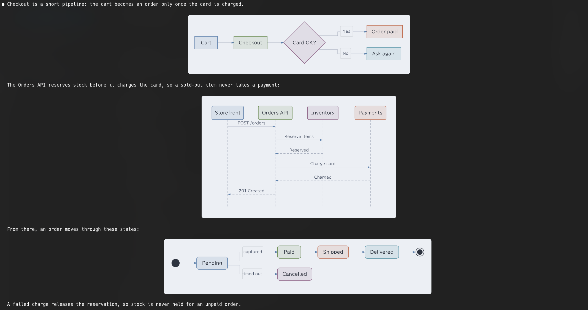
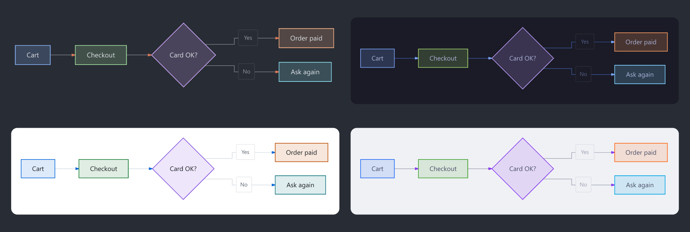

# Mermaid Tint

[English](README.md) | 日本語

Claude の返信にある Mermaid の図を、ターミナルの中にそのまま図として描く、Claude Code の [mod](https://code.claude.com/docs/en/plugins/mods/overview) です。
Claude が ` ```mermaid ` のコードブロックを書くと、その場所にコードではなく図が出ます。
ラベルは、まわりの文字と同じ大きさで描きます。
画像を出せないターミナルでは、同じ図を Unicode の罫線で描きます。



*Windows の gooztty で、テーマを `nord-light`、ラベルのフォントを BIZ UDPGothic にしたもの。*

[dazebug/mermaid-inline](https://github.com/dazebug/mermaid-inline) 0.1.3 を元に、Windows で使えるようにし、図の見た目と後片付けを直したものです。
元の作者と MIT のライセンスはそのまま引き継いでいます。
公開は 0.6.0 からです。
0.2.0〜0.5.2 は、公開する前に手元で直していたときの版です。

## 元の mermaid-inline との違い

- **Windows で使える**
  - フォントを Windows のフォントフォルダー（`~\AppData\Local\Microsoft\Windows\Fonts`・`%WINDIR%\Fonts`）からも探します。
    元は macOS と Linux のフォルダーしか探しませんでした。
  - `HOME` の無い Windows では、`USERPROFILE` をホームとして使います。
- **WSL の Claude Code を Windows のターミナルで使っても描ける**：図の PNG を、ファイルのパスではなくデータで渡します。
  元はパスで渡していたので、Windows のターミナルが WSL のファイルを開けず、空の枠になっていました。
  2 MiB を超える図だけは、今までどおりパスで渡します。
- **箱ごとに色を付ける**：フローチャート・状態遷移図・シーケンス図・クラス図・ER 図の箱に、テーマの配色から1つずつ違う色の枠を付け、中をその色で薄く塗ります。
  設定の `box_colors` を `false` にすると、元と同じテーマの1色に戻ります。
- **図が残り続けない**：描いた図は、セッションの scratchpad に置きます。
  Claude Code が古いセッションを片付けるときに、図も一緒に消えます。
  scratchpad の無いセッション（API キーでのログイン、Bedrock など）では、元と同じキャッシュのフォルダーに置きます。
  そこにある図は、`cleanupPeriodDays`（既定は 30 日）より古くなったら、セッションの開始時に消します。
- **線と矢印の描き崩れを直した**
  - 線の途中にできる 8px 未満の小さな段差を消します。
    元は、矢印の手前で線が少し折れて見えることがありました。
  - 矢印の向きを、resvg が読める形に書き直します。
    元は、クラス図の矢印が下向きの線でも右を向き、継承の三角・集約とコンポジションのひし形・`<-->` の始点の矢印が出ず、シーケンス図の左向きの矢印が右を向いていました。
- **日本語などのラベルでも罫線の図がずれない**：中国語・日本語・韓国語の文字や幅の広い絵文字のように、ターミナルで2マスになる文字を2マスとして配置します。
  元は、その後ろの罫線が1マス左にずれていました。
- **パッケージが無いことを知らせる**：図を描くための npm のパッケージが見つからないときは、次のプロンプトで Claude に知らせ、`/mermaid-tint` にも表示します。

## 動く環境

- Claude Code 2.1.331 以降の、ターミナルのセッション（`plugin.json` の `engines` で宣言しています）
- `PATH` に Node.js 18 以降と npm があること。
  Claude Code は、plugin を入れるときに npm で描画用のパッケージを入れ、mod は `node` で図を描きます
- 画像の図には、kitty graphics protocol で画像を出せるターミナルが要ります。
  Ghostty・cmux（Ghostty が土台）・kitty が対象で、tmux の中では出ません（tmux が画像を通さないため）。
  そのほかのターミナル（iTerm2・WezTerm・Terminal.app・Windows Terminal など）では、罫線の図になります
- macOS・Linux・Windows

デスクトップアプリ・VS Code・`claude -p` では何もせず、返信はいつもどおり表示されます。

## インストール

Claude Code のターミナルのセッションで、プロンプトに次のように入力します。

```
/plugin install mermaid-tint --marketplace khayasaka/claude-mod-mermaid-tint
```

marketplace を追加するか聞かれたら `y` で答え、スコープを選びます（最初に並ぶのはユーザーのスコープです）。

シェルから入れるときは、次のように実行します。

```
claude plugin install mermaid-tint --marketplace khayasaka/claude-mod-mermaid-tint
```

新しいセッションを始めるか、開いているセッションで `/reload-plugins` を実行します。
`/plugin` の有効な mod の一覧に `mermaid-tint` が載り、`/mermaid-tint` でこのターミナルで画像を描くかと、使うフォント・色・デザインが分かります。

元の mermaid-inline が入っていれば、先にアンインストールしてください。
両方入れると、同じ図を2つの mod が描こうとします。

mod は Claude Code の early access の機能で、API はリリースごとに変わることがあります。
この mod は Claude Code 2.1.331 で動作を確かめました。

## 更新

```
claude plugin marketplace update claude-mod-mermaid-tint
claude plugin update mermaid-tint@claude-mod-mermaid-tint
```

その後、Claude Code を起動し直します。
mod が自分で自分を更新することはありません。

## Windows で使うとき

- **ターミナル**：Windows で画像を出せるのは、今のところ Ghostty の Windows 向けの fork の gooztty で確かめただけです。
  Claude Code は、ターミナルの名前が kitty か Ghostty のときだけ画像を描くので、gooztty では次の2つが要ります。
  - 設定の `mode` を `on` にする（`auto` は、ターミナルを Ghostty か kitty と判定したときだけ画像にします）
  - 環境変数 `CLAUDE_CODE_FORCE_TERMINAL_IMAGES=1` を付けて Claude Code を起動する

  どちらも、画像を出せないターミナル（Windows Terminal など）で付けると、図が空の枠になります。
  gooztty のときだけ付くよう、PowerShell のプロファイルなどで `$Env:TERM_PROGRAM -eq 'gooztty'` を見て設定してください。
- **フォント**：Windows では、`font` が `auto` のままだと既定のフォントが見つかりません。
  インストール済みのフォントの名前（例：`BIZ UDPGothic`・`Yu Gothic UI`）を `font` に書いてください。
  日本語のラベルには、日本語の字形を持つフォントが要ります。
- **WSL**：WSL の Claude Code を gooztty で使うときは、Windows の環境変数 `TERM_PROGRAM` が WSL に渡るよう、`WSLENV` に `TERM_PROGRAM/u` を足してください。
  Linux では、日本語のラベルのために `fonts-noto-cjk` などを入れてください。

## 描ける図

フローチャート（`graph`・`flowchart`、向きはどれでも）、`sequenceDiagram`、`stateDiagram-v2`、`classDiagram`、`erDiagram`、`xychart-beta`（棒グラフと折れ線グラフ）です。
ほかの種類（`gantt`・`pie`・`mindmap` など）や、読み取れない図は、Claude が書いたままのコードブロックで残ります。

図を描くのは、コードブロックが閉じていて、返信の一番上の階層か、箇条書きの項目の中にあるときです。
箇条書きの中の図は、その項目の字下げの位置に描きます。
引用の中の図と、まだ書き出し中の図（閉じるフェンスが届いていないもの）は、コードのままです。
ターミナルより幅の広い図は、幅に収まるよう縮めます。
画面より高い図は、ラベルが元の 60% より小さくならない範囲で、画面の高さに近づけて縮めます。

ラベルの中の数式は、LaTeX と同じく `$` で囲んで書けます（`$$`・`\(…\)`・`\[…\]` も使えます）。
[LaTeX Inline](https://github.com/dazebug/latex-inline) が画像を出せない場所で使う Unicode の文字で描きます。
たとえば `$x^2$` は x²、`$\alpha \le \beta$` は α ≤ β、`$\frac{a+b}{c}$` は (a + b)/c になります。
`$5` のように数式を始めない `$` は、書いたままです。
線のラベルの `|x|` のように、文字にすると図の書き方が変わってしまう数式も、書いたままです。

画像を描くセッションでだけ、Claude のシステムプロンプトに短い節を足します。
Mermaid のブロックが図として表示されること、描ける種類、図を小さくラベルを短くすることを伝えるものです。
`teach_claude` を `false` にすると、システムプロンプトには何も足しません。
そのときは、Claude が自分から書いたときか、頼んだときだけ図が出ます。

[LaTeX Inline](https://github.com/dazebug/latex-inline) と一緒に使えます。
図と数式の両方を含む返信では、どちらが先に動いても、それぞれの mod が自分の部分を描きます。
2つの間の空行がそろうよう、LaTeX Inline は 0.3.3 以降を使ってください。

## デザイン

既定のテーマの `auto` は、ターミナルの背景の上に、ターミナルの文字の色で図を描きます。
矢印の先は Claude のオレンジです。
図がターミナルの一部に見えるようにするためです。
beautiful-mermaid のテーマを選ぶと、そのテーマの背景の上にカードのように描きます。
`colors` で、1色ずつ変えることもできます。



*左上から `auto`（暗い端末）、`tokyo-night`、`github-light`、`catppuccin-latte`。ラベルのフォントは Segoe UI。*

## 設定

`/plugin configure mermaid-tint@claude-mod-mermaid-tint` か、`/config` のパネルで設定します。
値は自分の設定の `pluginConfigs` に保存され、ほかの人には影響しません。

| 項目 | 既定値 | 意味 |
| :- | :- | :- |
| `mode` | `auto` | `auto` は、tmux の外の Ghostty・cmux・kitty では画像、ほかのターミナルでは罫線で描きます。`on` はいつも画像、`text` はいつも罫線で描き、`off` はコードブロックのままにします。 |
| `teach_claude` | `true` | 画像を描くセッションで、システムプロンプトに図の節を足します。 |
| `theme` | `auto` | `auto` か、`zinc-light`・`zinc-dark`・`tokyo-night`・`tokyo-night-storm`・`tokyo-night-light`・`catppuccin-mocha`・`catppuccin-latte`・`nord`・`nord-light`・`dracula`・`github-light`・`github-dark`・`solarized-light`・`solarized-dark`・`one-dark` のどれかです。 |
| `colors` | なし | テーマより優先する色を、`キー=#rrggbb` の組を空白で区切って書きます。キーは `bg`（背景）・`fg`（文字）・`line`（線）・`accent`（矢印の先・強調・グラフの系列）・`muted`（補助の文字）・`surface`（箱の塗り）・`border`（箱の枠）です。例：`accent=#7aa2f7 line=#5c6370` |
| `box_colors` | `true` | 箱ごとに、テーマの配色から違う色の枠と薄い塗りを付けます。`false` にすると、テーマの1色になります。図の中で `style` を書いた箱は、その色のままです。 |
| `font` | `auto` | ラベルのフォントです。`auto` は、macOS では Helvetica Neue、Linux では DejaVu Sans・Noto Sans・Liberation Sans です。またはインストール済みのフォントの名前を書きます。ハングルなどの CJK の文字は、その文字を持つシステムのフォントで描きます。 |
| `text_scale` | `1` | ターミナルの文字に対するラベルの大きさです。 |
| `node_path` | `node` | 描画に使う Node.js の実行ファイルです。 |
| `font_metrics` | `auto` | `auto` は、セッションの開始時にターミナルのフォントを測ります（下の節）。`manual` は、次の2つの値をいつも使います。 |
| `cell_aspect` | `2.125` | ターミナルのセルの高さを幅で割った値（ピクセル）です。 |
| `line_height` | `1.308` | ターミナルのフォントでの、セルの高さ（em）です。 |

使えなかった値（知らないテーマ名・形の崩れた色など）は、`/mermaid-tint` に表示します。

塗りの濃さは、背景が明るいときは 14%、暗いときは 20% です。
`auto` のテーマや、色の表に無いテーマでは、背景が明るければ GitHub Light、暗ければ Catppuccin Mocha の配色から色を選びます。

## ターミナルに合わせる

ターミナルは、画像を渡されたセルの大きさに引き伸ばして表示します。
そのため、図がゆがまないようにするにはセルの形を、ラベルをまわりの文字と同じ大きさにするにはセルの高さ（em）を知る必要があります。
`font_metrics` が `auto`（既定）のときは、[LaTeX Inline](https://github.com/dazebug/latex-inline#matching-your-terminal-font) と同じ方法で、セッションの開始時にこれを求めます。
ターミナルに設定されたフォントを探し（Ghostty の設定の最初の `font-family`、無ければ Ghostty の組み込みの JetBrains Mono。kitty は `kitty.conf` の `font_family`）、フォントのファイルから寸法を読んで、ターミナルと同じ方法でセルの大きさを計算します。
フォントを拡大しているときや、ターミナルの設定でセルを調整しているときは、測った値がずれます。
そのときは `font_metrics` を `manual` にして、`cell_aspect` と `line_height` を自分で入れてください。

`auto` のテーマは、ターミナルの背景と文字の色も、ターミナルの設定から読みます。
Ghostty は `background`・`foreground`、無ければ `theme` の色（`light:…,dark:…` の組は macOS のダークモードに従います）、どちらも無ければ Ghostty の既定の色です。
kitty は `background`・`foreground` で、`kitten themes` が書く `include` の行もたどります。
分からないときは、Claude Code のダーク・ライトのテーマに合う色を使います。
背景の色がずれていると、線のラベルの後ろの箱が違う色の四角に見えます。
そのときは、`colors` の `bg` にターミナルの背景の色を書いてください。

## 罫線の図

画像を出せないところでは、beautiful-mermaid の文字の描画で、図を Unicode の罫線で描きます。

```
┌────────────┐    ┌────────────┐    ┌──────────┐
│ Storefront │    │ Orders API │    │ Payments │
└──────┬─────┘    └──────┬─────┘    └─────┬────┘
       │                 │                │
       │  POST /orders   │                │
       │─────────────────▶                │
       │                 │                │
       │                 │  Charge card   │
       │                 │────────────────▶
       │                 │                │
       │                 │    Charged     │
       │                 ◀╌╌╌╌╌╌╌╌╌╌╌╌╌╌╌╌│
       │                 │                │
       │   201 Created   │                │
       ◀╌╌╌╌╌╌╌╌╌╌╌╌╌╌╌╌╌│                │
       │                 │                │
┌──────┴─────┐    ┌──────┴─────┐    ┌─────┴────┐
│ Storefront │    │ Orders API │    │ Payments │
└────────────┘    └────────────┘    └──────────┘
```

罫線の図は縮められないので、ターミナルより幅の広い図はコードブロックのままです。
箱の色付けは、罫線の図には付きません。

ターミナルで2マスになる文字（Unicode の East Asian Width で全角の、中国語・日本語・韓国語の文字、全角の英数字・記号、幅の広い絵文字）は2マスとして配置するので、その後ろの罫線の位置はずれません。
「○」「★」のような幅が決まっていない記号は1マスとして配置します。
そのため、これらを2マスで描く設定のターミナルでは、その後ろの罫線が1マスずれます。

## プライバシー

Mermaid Tint は、データを集めず、マシンの外に何も送りません。
サーバーを持たず、ネットワークにもつなぎません。
図はマシンの中の `node` のプロセスが描き、画像として scratchpad かキャッシュのフォルダーに置きます。
実行・読み書きするものは、すべて次の節に書いています。

## 実行・読み書きするもの

- **実行するもの**
  - `node bin/render.mjs`：新しい図をまとめて描くときに1回ずつ、plugin のフォルダーから実行します。
    図の Mermaid のコードは、標準入力で渡します。
    beautiful-mermaid で図を組み立て、画像のときは [resvg](https://github.com/RazrFalcon/resvg) で PNG にします。
  - `node bin/terminal.mjs`：Ghostty・cmux・kitty で画像を描くときに、セッションの開始時に1回実行します。
    macOS で Ghostty のテーマがダークモードに従うときは、`defaults read -g AppleInterfaceStyle` を実行します。
  - `node bin/prune.mjs`：キャッシュのフォルダーに古い図があるときだけ、セッションの開始時に1回実行します。
    渡されたフォルダーの中の、名前に区切り文字を含まない `.png`・`.json` だけを消します。
  - どれも Claude Code の `$.process.run` で、シェルを通さず引数の配列で、`node_path` の `node` を起動します。
    ターミナルの確認は 10 秒、描画は 60 秒で止めます。
    別の `node` のプロセスにしているのは、Claude Code が mod を Node.js の API も WebAssembly も無い環境で動かし、mod 自身のファイルしか読み込ませないためです。
    図を描く npm のパッケージは、その中では読み込めません。
- **書くもの**：図ごとの PNG と小さな JSON です。
  置き場所は、セッションの scratchpad の `mermaid-tint/v2` です。
  scratchpad の無いセッションでは、`$XDG_CACHE_HOME/mermaid-tint/v2`（既定は `~/.cache/mermaid-tint/v2`）です。
  キャッシュのフォルダーは、いつ消してもかまいません。
- **読むもの**
  - 上のファイル
  - ターミナルの設定：Ghostty の `config`（`~/.config/ghostty`、macOS では `~/Library/Application Support/com.mitchellh.ghostty`）と、`config-file` で読み込むファイル、`theme` で指定したテーマのファイル（`~/.config/ghostty/themes` か、Ghostty・cmux のテーマのフォルダー）。kitty は `~/.config/kitty/kitty.conf` と、そこから読み込むファイル
  - ターミナルのフォントを探して測るための、フォントのフォルダーにあるフォントのファイルのヘッダー
  - ラベルを描くフォント
  - 環境変数の `TERM`・`TERM_PROGRAM`・`KITTY_WINDOW_ID`・`TMUX`・`HOME`・`USERPROFILE`・`XDG_CACHE_HOME`・`XDG_CONFIG_HOME`・`GHOSTTY_RESOURCES_DIR`・`WINDIR`・`SystemRoot`
  - Claude Code の設定の `theme` と `cleanupPeriodDays`
- **ネットワーク**：動いている間は使いません。
  beautiful-mermaid は SVG にウェブフォントの `@import` を書きますが、描く前に取り除きます。
  resvg にはマシンの中のフォントのファイルを渡し、何も取りに行きません。
  plugin を入れるときに、Claude Code が `package-lock.json` で固定した npm のパッケージ（`beautiful-mermaid`・`@resvg/resvg-js` と、その依存）をダウンロードします。
- **送るもの**：マシンの外には何も送りません。
  図のコードはマシンの中の `node` に標準入力で渡し、画像はファイルとして返ってきます。
- **認証情報**：何も読みません。
- **hook**
  - `session.start`：このターミナルでの図の出し方を決め、画像のときはフォントと色を測り、`/mermaid-tint` を登録します。
    キャッシュのフォルダーの古い図も、ここで片付けます。
  - `classic.SessionStart`：scratchpad の場所を受け取ります。
  - `command.run`：`/mermaid-tint` に答えます。
  - `prompt.compose`：上で書いた図の節をシステムプロンプトに足します。
  - `prompt.submit`：描画用のパッケージが無いときに、Claude への知らせを1回だけ添えます。
  - `ui.render`：アシスタントのメッセージだけが対象です。
    Mermaid のブロックを含む返信を描き直し、図はこの mod が描いて、まわりの文章は Claude Code（と LaTeX Inline などのほかの plugin）に返します。
    保存されるメッセージは書き換えません。
- **Claude への変更**：上で書いた、画像を描くときだけのシステムプロンプトの節と、`/mermaid-tint` のコマンドです。

## 図を描けないとき

- 描けない種類の図や、読み取れない図はコードブロックのまま残り、返信のほかの部分は描きます。
  beautiful-mermaid は、ノードの ID を ASCII の英数字で書いたものしか読めません。
  ID をほかの文字で書いたフローチャートは何も描けないので、コードのままです（ラベルはどの文字でもかまいません）。
- 描画の `node` を起動できないとき（`node` が無い、パッケージが無いなど）は、すべての図がコードブロックのままで、次のセッションでまた試します。
- 新しい図を描いている間は、一瞬コードブロックが見えてから図に置き換わります。
  ターミナルの幅が変わると、新しい幅で描き直します。

## 制限

- 返信をターミナルからコピーすると、Mermaid のコードではなく、画像の代わりの文字がコピーされます。
- beautiful-mermaid の図の組み立て方は、mermaid.js と違うところがあります（間隔や線のラベルの位置など）。
  新しい書き方を読めないこともあります。
- クラス図で、同じ2つのクラスの間に2本目の関係（`A --> B` と `A <--> B` など）を書くと、beautiful-mermaid が2本目を描きません。
- ctrl+o で表示する Claude の思考は、コードブロックのままです。
  Claude Code に、mod がそこを描き直す方法が無いためです。
- ctrl+o のトランスクリプトの表示のように、Claude Code がメッセージの上に見出しを付けるところでは、図を含む返信の見出しの下に空行が1つ多く、図の後の文章の上に空行が無くなることがあります。
  Claude Code がそこでは空行を省き、mod からは普通の表示と見分けられないためです。

## うまく動かないとき

まず `/mermaid-tint` を実行してください。
このターミナルで画像と罫線のどちらで描くかと、画像のときは見つけたフォント・色と、使うデザインが分かります。
さらに調べるときは、`claude --debug` で Claude Code を起動し、デバッグのログで `mermaid-tint` を探します。
`not loaded:` で終わる行は、mod が読み込まれなかった理由です。
`ui.render (AssistantMessage) refused` の行は、Claude Code が受け付けなかった描画です。

## 開発

clone したフォルダーを、`claude --plugin-dir ./claude-mod-mermaid-tint` で1回のセッションだけ読み込めます。
その場で読み込んだ plugin には Claude Code がパッケージを入れないので、先に clone の中で `npm ci --ignore-scripts` を実行してください。
`claude plugin test` で、コードの読み取りと hook のテストを実行します。
`node --test tests/*.test.mjs` で、描画・色・フォントの測定のテストを実行します。

## 謝辞

- 元の plugin は、dazebug の [mermaid-inline](https://github.com/dazebug/mermaid-inline) です。
- 図の組み立ては、Craft の [beautiful-mermaid](https://github.com/lukilabs/beautiful-mermaid) です。
  文字の描画は Alexander Grooff の [mermaid-ascii](https://github.com/AlexanderGrooff/mermaid-ascii) が元で、配置には [ELK](https://github.com/kieler/elkjs) を使っています。
  画像にするのは [resvg](https://github.com/RazrFalcon/resvg) です。
- ターミナルのセルは、[Ghostty](https://github.com/ghostty-org/ghostty)（MIT）の `src/font/Metrics.zig` と同じ方法で測ります。
  コードは [LaTeX Inline](https://github.com/dazebug/latex-inline) と共通です。
- ラベルの数式は、LaTeX Inline の変換のコードを写した `hooks/tex.ts` で文字にします。
- キャッシュのファイル名には、bryc がパブリックドメインで公開している文字列のハッシュ [cyrb53](https://github.com/bryc/code/blob/master/jshash/experimental/cyrb53.js) を使っています。
- 箱の色付けは、[NahumLitvin/prismantis](https://github.com/NahumLitvin/prismantis) が文字の図で箱ごとに色を変えているのを参考にしました。

## ライセンス

MIT です。[LICENSE](LICENSE) を見てください。
npm から入れる描画用のパッケージは、それぞれのライセンスに従います。
beautiful-mermaid（MIT）、elkjs（EPL-2.0）、entities（BSD-2-Clause）、resvg-js（MPL-2.0）です。
